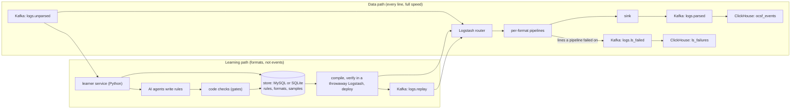

# Self-learning security log parser

The main document of this repository: what the system does, what each part of the code is, how the core
works with Kafka, Logstash, ClickHouse, the store and the UI, how to set it up on a new machine, and how
changes travel between the machines that run it (this development machine and the GRA machine).

- Status: all six build phases done (2026-11-22). Next step: integration with GRA (section 13).
- Deployment specifics for GRA: [docs/HANDOFF_GRA.md](docs/HANDOFF_GRA.md).
- Variant A vs Variant B results: [docs/AB_COMPARISON.md](docs/AB_COMPARISON.md).
- Open items: [docs/BACKLOG.md](docs/BACKLOG.md). Rule language: [docs/RULES.md](docs/RULES.md).
- Per-machine setup (macOS development machine, Linux GRA machine): [README2.md](README2.md).

---

## Contents

1. [What it does](#1-what-it-does)
2. [The two paths: data and learning](#2-the-two-paths-data-and-learning)
3. [The core, and what is outside it](#3-the-core-and-what-is-outside-it)
4. [Repository map](#4-repository-map)
5. [How a line is handled](#5-how-a-line-is-handled)
6. [How a new format is learned](#6-how-a-new-format-is-learned)
7. [Logstash: the two rule writers and the deploy](#7-logstash-the-two-rule-writers-and-the-deploy)
8. [Self-audit, drift and review](#8-self-audit-drift-and-review)
9. [Storage: what is kept where](#9-storage-what-is-kept-where)
10. [Kafka topics and ClickHouse tables](#10-kafka-topics-and-clickhouse-tables)
11. [The UI and its API](#11-the-ui-and-its-api)
12. [Setting up a machine](#12-setting-up-a-machine)
13. [Working across machines](#13-working-across-machines)
14. [Testing](#14-testing)
15. [Configuration and environment](#15-configuration-and-environment)
16. [Design decisions](#16-design-decisions)
17. [Status and open items](#17-status-and-open-items)

---

## 1. What it does

Security logs arrive on a Kafka topic in many formats, most of them unknown in advance. The system:

- groups the lines by format,
- has bounded AI agents learn each new format once, writing **rules as data** (never code),
- checks every rule in code before it is used,
- turns the rules into **Logstash pipelines** that parse every line into an **OCSF 1.10.0** event,
- writes the events to a parsed Kafka topic that **ClickHouse** ingests,
- audits what it learned, notices when a format changes, and hands what it cannot fix to a person.

AI is never called per event. A format costs model time once (about $0.12 with the recommended writer);
after that, Logstash parses its lines at full speed with no model involved.

## 2. The two paths: data and learning



- **Data path.** Logstash reads `logs.unparsed`, routes each line to its format's pipeline, and the sink
  writes the OCSF event to `logs.parsed`; ClickHouse consumes that topic. Events live only in ClickHouse.
- **Learning path.** The Python learner reads the same topic in batches, groups lines by format, and keeps
  a bounded set of recent lines and samples per format in the store. Formats without a rule go to the
  agents. When rules change, the learner compiles them, verifies them in a throwaway Logstash, writes the
  verified pipelines into Logstash's live directory (Logstash reloads them), and replays the kept lines of
  newly deployed formats through `logs.replay`.

The learner may lag behind or sample without slowing the data path.

## 3. The core, and what is outside it

**The core** is the code that should be the same on every machine. Changes to it are made in one place and
travel to the other machines (section 13).

| Core part | Files |
|---|---|
| Engine: detect, mask, sign, group, parse, map, validate | `logparser/engine.py`, `detect.py`, `signature.py`, `family.py`, `formats.py`, `parsers.py`, `ocsf.py`, `transforms.py`, `rx.py`, `reader.py`, `config.py` |
| Rules as data | `logparser/registry.py`, `registry/builtin.json`, `registry/seeds/`, `docs/RULES.md` |
| Agents and their gates | `logparser/harness.py`, `tools.py`, `checks.py`, `detection.py`, `repair.py`, `shadow.py`, `prompts/` |
| Logstash writers | `logparser/logstash.py` + `logstash_rb.py` (Variant A), `lsdirect.py` + `sandbox.py` (Variant B) |
| Audit, drift, review | `logparser/audit.py`, `lsaudit.py`, `review.py`, `compare.py` |
| Learning service | `logparser/service/` (runner, deploy, clickhouse, config) |
| Store interface | `logparser/store.py` (interface + SQLite), `store_mysql.py` (MySQL 8) |
| OCSF schema | `logparser/data/ocsf-1.10.0.json` |

**Outside the core** (adapted per machine; changes here are normal and expected):

| Part | Files | Adapt on GRA |
|---|---|---|
| Service configuration | `deploy/service/*.json` | brokers, topics, store url, ClickHouse, budgets, variant |
| Engine thresholds | `config/production.json` | retention, thresholds (keep the retention caps) |
| Logstash sink and inputs | `deploy/logstash/*.conf` | only if GRA's sink differs |
| ClickHouse schema | `deploy/clickhouse/schema.sql` | table names / engines if GRA has its own |
| Location of tools | `logparser/lsenv.py` (env-driven) | set `LP_LOGSTASH_BIN`, `LP_LOGSTASH_HOME` |
| Local test infrastructure | `scripts/kafka.sh`, `mysql.sh`, `logstash.sh`, `deploy/kafka/server.properties` | not used on GRA |
| UI and console | `ui/`, `logparser/web.py`, `logparser/console.py` | access control in front of it |

**Never in git:** `data/` (datasets), `work/` (run databases, Logstash working dirs, sandbox), `.env`
(API key and secrets), `logparser/web/dist/` (built UI), `deploy/logstash/generated/` (compiler output).

A rule of thumb for GRA work: if a change is needed because GRA is different (hosts, credentials, topic
names, versions), it belongs outside the core, in configuration or an adapter. If a change is needed because
the logic is wrong or missing, it is a core change and must be sent back (section 13).

## 4. Repository map

```
logparser/                      the Python package (core)
  engine.py         the deterministic pipeline; no AI is called from it
  reader.py         file and Kafka readers behind one interface; record framing
  detect.py         ordered format checks (headers, JSON, kv, CEF, XML ...) loaded from the registry
  detection.py      agent-added detection rules for lines no rule reads (fallbacks, time formats, zones)
  signature.py      masking and template signatures (the format identity of a line)
  family.py         source families: a line's source worked out from its content
  formats.py        decoders for structured formats (JSON, key=value, CEF, LEEF, delimited, XML)
  parsers.py        runs one parser rule on one record
  ocsf.py           OCSF schema access, the mapper, the validator
  transforms.py     the fixed transform library mapping rules may call
  rx.py             every rule pattern runs on RE2 (linear time)
  registry.py       rule kinds (JSON Schema per kind), validation, versions, rollback, export/import
  store.py          storage interface and SQLite implementation; open_store(url)
  store_mysql.py    MySQL 8 implementation (dialect translated in one place)
  config.py         engine thresholds (settings)
  harness.py        the agent loop on the Claude API: roles, budgets, shares, fix rounds
  tools.py          the agents' tools and the save gates
  prompts/          one prompt per agent role, plus common.md
  checks.py         meaning checks (time from the line, outcome words)
  audit.py          Variant A self-audit (engine re-parses stored lines)
  repair.py         self-correcting grouping (merge, split, remask) with replay checks
  shadow.py         new rule versions run beside live traffic before promotion
  logstash.py       Variant A: compile rules to Logstash; also the shared router, sink and Kafka io
  logstash_rb.py    the Ruby runtime library embedded in generated pipelines (module LP)
  lsdirect.py       Variant B: agent-written Logstash filters as checked steps; the gate; deploy check
  sandbox.py        a warm local Logstash for testing Variant B filters
  lsenv.py          where Logstash is installed on this host
  lsaudit.py        Variant B audit and drift check (newest stored lines + ClickHouse read-back)
  review.py         human corrections; the review inbox (answer / ignore / dismiss); the drift report
  compare.py        Variant A vs Variant B on one mixed stream (phase 5)
  sink.py           ClickHouse sink used by the engine-side UI flow
  web.py            web UI server and JSON API (serves the built React app)
  console.py        a small local console for the compiled pipelines
  cli.py            operator command line (init, run, status, metrics, export, import, rollback ...)
  envfile.py        reads .env into the environment
  service/
    __main__.py     python -m logparser.service --config FILE [--deploy-now] [--status]
    runner.py       Kafka consumer, batching, dedup, offsets, learning cycles in a thread
    deploy.py       compile, verify, swap into Logstash's live dir, replay (both variants)
    clickhouse.py   ClickHouse tables and Kafka-engine ingestion
    config.py       the service configuration (all site-specific settings)
  data/ocsf-1.10.0.json   the OCSF schema export
registry/
  builtin.json      generic rules: framing, detection checks, masks, dialects, default mapping
  seeds/            vendor rules from open-source parsers (each with source and licence)
  exports/          rule exports from earlier dataset runs (reference, not loaded automatically)
config/production.json     engine settings for real deployments (retention caps)
deploy/
  service/          local.json (this machine), production.example.json (GRA template)
  logstash/         sink and input templates used by the compiler
  clickhouse/       schema.sql (event table)
  kafka/            server.properties for the local test broker
ui/                 React + shadcn console (Vite); builds into logparser/web/dist
scripts/            local infrastructure, data tools, verification
  kafka.sh clickhouse.sh mysql.sh logstash.sh   start/stop local Kafka (19092), ClickHouse (8123), MySQL (13306), Logstash
  produce.py        push log files into a topic as one mixed stream
  promote_rules.py  copy learned rules from one store to another (e.g. local SQLite -> GRA MySQL)
  ls_verify.py      run a compiled set in a throwaway Logstash and compare with the engine
  retemplate_longtail.py, build_*.py, *_score.py, *_report.py   dataset and evaluation tools
bin/lp-tool         command-line wrapper for the agents' tools
tests/              pytest suite (214 tests); conftest.py switches the store to MySQL on demand
eval/labels.jsonl   evaluation labels from the first dataset run
docs/               RULES.md, HANDOFF_GRA.md, AB_COMPARISON.md, RESULTS.md, BACKLOG.md
LOG_PARSER_SPEC.md, LOG_PARSER_SPEC_v2.md   the original design brief
changes/            change notes exchanged between machines (section 13)
```

## 5. How a line is handled

In the engine (learner side) and, after compilation, the same way in Logstash:

1. **Framing** splits the stream into records (multi-line, octet counting).
2. **Detection** runs ordered checks from the registry: syslog headers (RFC 3164, 5424, ISO), JSON,
   key=value, CEF, LEEF, XML, delimited. The header fields become `@timestamp`, `@host`, `@app`, `@pid`, and
   the rest is the payload.
3. **Masking and signature.** Variable values (IPs, numbers, ids, quoted strings) are masked; the template
   plus the structure is hashed into a **signature**: the format identity. Structured formats sign on key sets
   and event-type fields; a new key set that overlaps a known one by 80% joins it as a variant.
4. **Grouping.** A signature maps to a **group** (one format). Near-duplicate templates are merged by an exact
   check; the grouping agent can merge, split or remask, and each operation is replay-checked.
5. **Parsing and mapping** with the group's rules give an OCSF event, validated against the schema.
6. Lines of a group with no rule stay **pending** (kept up to the retention cap) until a rule arrives; then
   they are replayed.

## 6. How a new format is learned

Agents work from queues that code fills. Each agent call is bounded (5-8 turns per item, a share of the cycle
budget, predictive stop before the cap). Agents act only through tools; a save is accepted only if its gate
passes.

| Role | Queue | Writes | Gate (in code) |
|---|---|---|---|
| `detection` | needs-detection | detection rules for unreadable headers (time format, zone) | reads every sample; changes no line already read; plausible times; no host names in patterns |
| `source-naming` | needs-source | vendor / product of a source | claims only the sources it names |
| `grouping-repair` | grouping-repair | merge, split, remask, classify fields | replay check on stored lines |
| `parser-gen` (A) | needs-parser | parser rule (regex, kv, json ...) | full match on samples, holdout match, every value literally in its line |
| `ocsf-mapping` (A) | needs-mapping | OCSF mapping rule | every sample gives a schema-valid event; meaning checks |
| `longtail` | longtail | summary rules for small formats | daily budget; values from masked slots |
| `ls-direct` (B) | needs-lsfilter | a whole Logstash filter as structured steps | runs in the real Logstash sandbox: every line passes (schema, values in line, time from line, outcome words, mapped fields present, no lines of other formats read) |

Budgets: `learning.budget_usd_per_cycle` and `_per_day` cap spend; each role gets a share (`SHARES` in
`harness.py`) in a fixed priority so no single agent spends the whole cycle. Spend per item is in the
`tool_calls` table.

Log lines are untrusted: they reach agents as data inside tool results, never as instructions, and an agent
can only produce rules that pass the gates. Variant B steps are validated before rendering: no ruby, exec,
file or network plugins; no `${`, line breaks or trailing backslashes in values; plain dissect keys.

## 7. Logstash: the two rule writers and the deploy

Both writers share the router, the sink, the Kafka io and ClickHouse. Choose with `logstash.variant`.

- **Variant A, `compiled`.** Parser and mapping rules for the engine are compiled to Logstash. A format is
  kept only where Logstash's event equals the engine's, line for line. Handles split groups.
- **Variant B, `direct` (recommended).** One agent writes the whole filter (grok, dissect, kv, json, xml,
  csv, date, mapping) as JSON steps; `lsdirect.py` validates and renders them. Tested in a warm sandbox
  Logstash (`sandbox.py`, 127.0.0.1:18080 / API 9611) during learning; verified again at deploy.

Phase 5 compared them on the same 20,000 lines: equal correctness, B covered more formats because one agent
handles a format end to end (data inside a JSON `Message` or a positional tail). See
[docs/AB_COMPARISON.md](docs/AB_COMPARISON.md).

**A generated set** (written by `write_set` into `logstash.config_dir`):

```
pipelines.yml         distributor, one pipeline per source, sink (pipelines.yml written last)
distributor.conf      Kafka input; detection, bucket, signature -> route key -> [@metadata][dest]
src_<source>.conf     the formats of one source: route key -> parse -> map -> OCSF event
sink.conf             flatten to ClickHouse columns -> logs.parsed; failed lines -> logs.ls_failed
lp_lib.rb             the LP Ruby library (decoders, mapping helpers, finishing)
tables_*.json         per-pipeline tables (detection rules, dialects, captions)
logstash.yml, jvm.options, log4j2.properties
```

**Deploy** (`service/deploy.py`): snapshot the store (MySQL is exported to a SQLite snapshot) → compile →
run a throwaway Logstash on stored lines of every format → leave out formats that fail or read other
formats' lines, repeat → write the verified set to a staging dir → move it into the live dir (Logstash
reloads; `config.reload.automatic`) → replay kept lines of newly deployed formats to `logs.replay`.

## 8. Self-audit, drift and review

- **Variant A audit** (`audit.py`): the engine re-parses stored lines of saved formats and checks values,
  time, outcome, schema. Failures go back to the owning agent with examples; after `audit_max_rounds` to a
  person (`human-review` queue).
- **Variant B audit** (`lsaudit.py`): each saved filter runs again in the sandbox on up to 200 of its newest
  stored lines, and events already in ClickHouse are read back (newest arrivals) and checked, including
  "a field the filter always maps is missing" (a renamed key). Same routing to agent, then to a person. Runs
  after every learning cycle and from the Review page. (Hourly scheduling: backlog.)
- **Drift report** (`review.drift`): rules that started failing, new key sets on known formats, new formats
  from a known source, deployed formats gone quiet, and lines the live Logstash failed on (`ls_failures`).
- **Review** (`review.py`, Review page): everything waiting for a person. *Answer and retry* sends the answer
  to the agent with the item and keeps it as a correction it sees later; *Ignore this group* leaves a format
  unparsed on purpose; *Dismiss*. Questions not about one format become decisions the agents read.

## 9. Storage: what is kept where

The store (SQLite locally, MySQL 8 on GRA) holds **rules, format metadata and a bounded working set**. Events
are not stored there; they live in ClickHouse.

| Table | Holds | Growth |
|---|---|---|
| `rules` | every rule kind, all versions | with formats learned |
| `groups`, `group_signatures`, `sources`, `families`, `group_stats` | one row per format / source | with new formats, not traffic |
| `samples` | example lines per format | fixed per format |
| `raw`, `events`, `dlq` | recent lines per format and the engine's parse of them | capped: `retain_parsed` 200 + `retain_unparsed` 1000 per format |
| `queue`, `decisions`, `corrections`, `operations`, `shadow`, `state` | agent work, review answers, audit trail, counters | small |
| `tool_calls` | every agent tool call and model call (cost) | with learning activity; no cleanup yet |

The caps come from `config/production.json`; the code's default is 0 (keep everything), so real deployments
must run with `engine_settings: config/production.json`. MySQL setup: [docs/HANDOFF_GRA.md](docs/HANDOFF_GRA.md)
section 4.

## 10. Kafka topics and ClickHouse tables

| Topic | Written by | Read by | Carries |
|---|---|---|---|
| `logs.unparsed` | producers (existing) | Logstash (from latest), learner (own group) | raw lines |
| `logs.parsed` | Logstash sink | ClickHouse Kafka engine | one JSON per OCSF event, flattened |
| `logs.replay` | learner at deploy | Logstash (own group, from earliest) | kept lines of newly deployed formats |
| `logs.ls_failed` | Logstash sink | ClickHouse Kafka engine | lines a deployed pipeline failed on (pipeline, reason) |

ClickHouse (`clickhouse.database`, created by `service/clickhouse.py` when `ingest: true`):
`ocsf_events` (MergeTree: class, activity, type, severity, status, IPs, user, vendor, product, group id,
rule versions, `event_json`, raw `message`, `ingested_at`), `parsed_queue` + `parsed_mv` (Kafka ingestion),
`ls_failures` + queue + view (30-day TTL).

## 11. The UI and its API

React + shadcn (`ui/`), built with Vite into `logparser/web/dist`, served with the JSON API by
`python -m logparser.web --db STORE_URL --clickhouse URL [--ch-db DB] --port 8090`.

| Page | Shows |
|---|---|
| Ingest | paste or upload lines, or stream a file / Kafka topic through the engine |
| Events | OCSF events in ClickHouse, filterable |
| Unparsed | lines without a rule, by format |
| Sources & groups | sources, their formats, a format's samples, rules and stats |
| Rules | every rule and its versions |
| AI agents | the queues; start a capped learning run (model, roles, budget); run the self-audit |
| Review | items for a person (answer / ignore / dismiss); Variant B audit; drift report |

API endpoints (`web.py`): `GET /api/overview, events, unparsed, sources, groups, group, rules, rule, queue,
streams, learn, review/inbox, review/drift`; `POST /api/ingest, streams, learn, learn/stop, audit,
review/answer, review/resolve, review/lsaudit`. The UI has no login: put it behind access control.

Development: `cd ui && npm install && npm run dev` (proxies `/api` to 127.0.0.1:8090). Build:
`npm run build` (Node 20+; tested with Node 24).

## 12. Setting up a machine

```sh
git clone <repo> && cd <repo>
uv venv --python 3.12 .venv            # or: python3.12 -m venv .venv
uv pip install --python .venv/bin/python -r requirements.txt pytest
LP_SKIP_LOGSTASH=1 .venv/bin/python -m pytest -q        # 211 pass on a fresh clone (3 need Logstash)

cp .env.example .env                    # ANTHROPIC_API_KEY=... (never commit .env)
(cd ui && npm install && npm run build) # the console
```

Then, per machine:

- **This machine (development, macOS):** `scripts/kafka.sh start`, `scripts/clickhouse.sh start`,
  `scripts/mysql.sh start` (optional), `scripts/logstash.sh start`, service config `deploy/service/local.json`.
  Versions, ports and measurements: [README2.md](README2.md#macos-development-machine).
- **GRA (Linux):** record the machine's setup in [README2.md](README2.md#linux-gra-machine). Start from
  `deploy/service/production.example.json`; MySQL database and user, topics, Logstash
  location and ClickHouse as in [docs/HANDOFF_GRA.md](docs/HANDOFF_GRA.md). Learning stays off until enabled.

Running:

```sh
.venv/bin/python -m logparser.service --config CONFIG.json               # the learner
.venv/bin/python -m logparser.service --config CONFIG.json --deploy-now  # compile, verify, deploy, exit
logstash --path.settings <logstash.config_dir>                           # the pipelines
.venv/bin/python -m logparser.web --db STORE_URL --ch-db DB              # the console
.venv/bin/python -m logparser.lsaudit --db STORE_URL --clickhouse URL --ch-db DB   # Variant B audit
.venv/bin/python scripts/promote_rules.py --from SOURCE_STORE --to TARGET_STORE    # carry learned rules
```

## 13. Working across machines

The repository is cloned on more than one machine: this development machine, and the GRA machine where the
system is integrated and tested with GRA's data. Each machine may have its own Claude Code session. Changes
travel as **change notes**: one text file per change, kept in `changes/`, so either side can read, apply and
answer them.

**Rules**

1. The core (section 3) stays identical on all machines. A core change made on one machine is sent to the
   others as a change note and applied there, not rewritten separately.
2. Site adaptations (configuration, credentials, hosts, topic names) stay on their machine. Mention them in a
   note only when the other side needs to know (for example "GRA's Kafka uses SCRAM-SHA-512").
3. Secrets never go into a note, a commit or a config file: use `${ENV}` references.
4. After applying a note, run the tests on both stores, commit, and record it in `changes/APPLIED.md`.

**A change note** (`changes/<machine>-<YYYYMMDD>-<short-topic>.md`, template in
[changes/TEMPLATE.md](changes/TEMPLATE.md)) says:

- where it comes from (machine, commit it was made on),
- what changed and why (the problem seen, with an example line or error if there is one),
- whether it touches the core or only the edge,
- the patch itself: the output of `git diff` (or `git format-patch`) for the changed files, inside a
  `diff` code block,
- how it was tested and what still needs checking.

To make a note from a working copy: `git diff > /tmp/change.patch` (or `git diff <commit>..HEAD`), then paste
it into the note. To apply a note's patch: save the block as a file and run `git apply --3way change.patch`.
Where a patch does not apply because the files differ, the description is enough to redo the change by hand.

## 14. Testing

```sh
.venv/bin/python -m pytest -q                                   # SQLite, includes real-Logstash tests
LP_SKIP_LOGSTASH=1 .venv/bin/python -m pytest -q                # without Logstash
scripts/mysql.sh start && LP_TEST_STORE=mysql .venv/bin/python -m pytest -q    # the same suite on MySQL
```

The suite (214 tests; 213 run here, one needs a trained database) covers the engine, grouping and repair, detection, the agent loop with a scripted fake
model, both Logstash writers (rendering, injection refusals, every plugin in a real Logstash), the gates,
audit and drift, the review inbox, the service (Kafka consumer fake, budgets, deploy), the comparison and the
MySQL store. `tests/conftest.py` redirects every store a test opens to its own MySQL database when
`LP_TEST_STORE=mysql`. A test guards the store layer: SQL that the MySQL translator cannot handle fails the
suite.

Paid runs (real model calls) are never part of the suite; each one is proposed with a dollar cap first.

## 15. Configuration and environment

Service configuration (`logparser/service/config.py`; example in `deploy/service/production.example.json`):
`kafka.*` (bootstrap, topics, groups, batching, `extra` for the Python client, `logstash_extra` for the
Logstash kafka plugins), `store.url`, `engine_settings`, `learning.*` (enabled, interval, model, roles,
limit, fix rounds, budgets), `logstash.*` (variant, config dir, deploy, verification, workers, heap),
`clickhouse.*` (url, database, ingest). `${NAME}` in values is filled from the environment.

| Variable | Used for |
|---|---|
| `ANTHROPIC_API_KEY` (or `ANTHROPIC_AUTH_TOKEN`) | model calls; `ANTHROPIC_BASE_URL` routes them through a gateway |
| `MYSQL_PASSWORD`, `KAFKA_PASSWORD`, `KAFKA_JAAS_CONFIG` | example secrets referenced as `${...}` in the config |
| `LP_LOGSTASH_BIN`, `LP_LOGSTASH_HOME` | Logstash executable and install dir, when not on PATH / Homebrew |
| `LP_OCSF_SCHEMA` | another OCSF schema file than the shipped one |
| `LP_TEST_STORE=mysql`, `LP_TEST_MYSQL`, `LP_SKIP_LOGSTASH`, `LS_SLOW` | test switches |
| `LP_DB` | store used by `bin/lp-tool` |
| `LP_NOW` | fixed clock for Logstash in verification runs (set by the code) |

Engine thresholds (`logparser/config.py`, overridden by `config/production.json`): grouping threshold,
retention caps, drift overlap and failure counts, audit rounds, long-tail budget, shadow mode.

## 16. Design decisions

- **Engine fixed, formats are data.** No vendor names in engine code; every format decision is a rule with a
  JSON Schema, versions and rollback. Rule patterns run on RE2 (linear time).
- **Code decides, agents propose.** Every save goes through a gate in code; agents never write code. Variant
  B's filters are structured steps, rendered by code.
- **Verified before deploy.** Logstash never gets a format that failed on its own stored lines or read lines of
  another format.
- **Near-duplicate merge by an exact check.** Drain3 merged different events that share a header; the default
  merges templates equal everywhere but one position (or two that change together) with enough distinct
  values. Drain3 remains a candidate generator (`merge_candidates = "drain"`).
- **Structured signatures** use the key set and event-type fields; an 80%-overlapping key set joins a known
  format as a variant.
- **Bounded learning.** Per-cycle and per-day dollar caps, shares per agent, a predictive stop, 5-8 turns per
  item, and a person for what does not converge.
- **Bounded store.** Lines are kept per format up to a cap; events go to ClickHouse only.

## 17. Status and open items

Done: engine and registry; agents with gates; Variant A and Variant B with verified deploys; Kafka learner
service; ClickHouse ingestion; self-audit, drift and the failure trace; review UI; A vs B comparison; MySQL
store with the full suite passing on SQLite and MySQL 8.4; GRA hand-off.

Measured on the test data (42 files): about $0.12 per new format with Variant B; 521,000 live events into
ClickHouse with every sampled event passing the checks; learner about 1,500 lines/s per process on a laptop.

Open before production on GRA (details in [docs/BACKLOG.md](docs/BACKLOG.md)):

- Secured Kafka (SASL/TLS) not yet tested; ClickHouse's Kafka-engine tables have no SASL settings yet.
- Running Variant A and B in one deployed set is not built (a deploy writes one variant's set).
- Learner throughput vs GRA's volume: sampling or several learner instances if needed.
- Model gateway: route via `ANTHROPIC_BASE_URL`; switches still to add for model-call logging, the
  server-side fallback beta, and `tool_calls` retention.
- Hourly audit in the service; service units, metrics and alerting; login for the UI.
- First step on GRA: a shadow pilot (own consumer group, separate parsed topic and ClickHouse database,
  learning off, then small capped runs).
